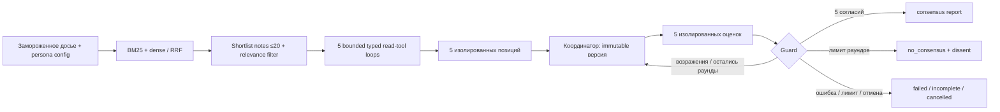

Current2026-10-09: completed original-input real1-round no_consensus exit0,5positions+1proposal+5validvotes. FR-1 minimal distinction; FR-2/3 complete; semantic FR-4/6 PASS WITH RISK, actual FR-5 relevance confirmed. Full188passed28.94s;3/3authorized paid runs consumed. [Итоговый отчёт](output/db37d3dc137a4969935f9f23a692bbf1/report.md) · [Независимая оценка и ограничения](../docs/agent-base/features/multi-agent-consensus/handoffs/acceptance-review/result.md). Earlier checkpoints below are historical.

## Завершённый совет с разногласиями

Для одного полного раунда используйте `.\.venv-consensus\Scripts\python.exe -m council.main --mode model --reasoning-effort none --aitunnel-test-mode --max-rounds 1` из корня проекта. `--max-rounds` задаёт 1–3 проверяемых версии, по умолчанию 3. После пяти валидных оценок результат может быть `no_consensus`: отчёт включает общий план, пять взглядов, условия, возражения, неподтверждённые утверждения и запросы недостающих данных. Это завершённое обсуждение без единогласия; оно не означает одобрения плана всеми персонами. Ошибки/переполнение продолжают давать failed/incomplete. Тестовый AI Tunnel и reasoning none сохраняют прежние ограничения качества; досье является моковыми данными.

# Совет консультантов — LangGraph и проверяемые источники

Current retained R2f: user requested to leave the demonstrated SYNTHETIC34037-byte context and stop optimizing. Complete suite188passed54.55s; codec independent PASS WITH RISK/CIT-T01 fixed.32768 cap unchanged, sizing FAIL; no further paid call, full FR-1–FR-9 acceptance remains open. Exact history and artifacts: docs/agent-base/features/multi-agent-consensus/citation-stabilization.md.

## Latest r10 / R2e

Последний separately authorized live `b8a17d9bdec54861882e922a0adc2cc3`:5first-try exact-ID initial positions1218–1344bytes +1draft, затем FAILED на review protocol,0atomicvotes. Дополнительный лимит1/1 исчерпан. Saved draft содержит assumption c4 без связанной caveat; early coordinator guard+specific safe protocol repair реализованы offline. **159passed48.44s exit0**, independent design PASS WITH RISK, independent actual code review PASS WITH RISK/49focused15.51s. Полное FR-1–FR-9 outcome не принято; точную причину всех rejected votes старый generic trace не сохраняет. [Все actual results/диагноз/guards/gates](../docs/agent-base/features/multi-agent-consensus/citation-stabilization.md). Ниже исторические checkpoint/evidence.

Пять симулируемых персон из `data/personas.md` независимо формируют исходные позиции по замороженному досье. Координатор предлагает версию решения; все пять оценивают один и тот же проект. Только код разрешает consensus по пяти явным согласиям с точными run/snapshot/version/digest. При возражениях — новый раунд; при лимите — no_consensus с сохранёнными разногласиями. Человек принимает итоговое решение после отчёта.

**Два режима**: `scripted` использует сценарные fixtures для проверки протокола; `model` подключает AI Tunnel или прямой OpenAI. Пользователь задаёт модель и ключ. Адаптеры проверяются offline через HTTP fixtures; реальное соединение подтверждено; полный живой совет пока не получен (см. актуальное evidence ниже). Реальный поиск использует BM25 и Sentence Transformers на CPU; synthetic vectors используются только в отдельных unit tests.

## Текущий результат r10 / citation stabilization

**154passed58.87s exit0**, независимый latest code review PASS WITH RISK (34focused). Модель выбирает literal q-ID из request-local schema enum; backend разрешает его в заранее показанный exact frozen excerpt с original provenance. Свободное quote copying не принимается; exact quote/digest/visibility guards не ослаблены. Точные источники ещё требуют смысловой оценки: совпадение текста не доказывает утверждение.

Новый бюджет3/3 исчерпан. Лучший live2 дал5positions+1draft без citation/schema/protocol errors, но review был incomplete; [последний live3](output/10556af0245c429fa1f0fafe16bf7ee9/report.md) FAILED по generation byte budget1600. После него внесён только offline delta: умеренные generation field bounds и safe numeric addressed repair, without cap increase/truncation. Верхние границы DTO/Unicode/conflicts могут всё ещё превышать1600, а mandatory closure/ledger —32768. Полный FR-1–FR-9 outcome не принят; новый paid run требует отдельного бюджета. [Изменения/альтернативы/все actual outcomes](../docs/agent-base/features/multi-agent-consensus/citation-stabilization.md). Ниже исторический C01–C06 evidence.

## Исторический результат C01–C06 / 2026-10-09

133 теста прошли за 12.94 с (exit0); репрезентативный масштаб 1200 документов / 300 заметок — PASS. Полный запрос: 22 906 байт; время: 14.713 с; sampled peak памяти дерева процессов: 620.4 MiB. Измерение использует настоящий encoder и scripted классификатор; качество live filter этим не подтверждается. [Масштаб](output/scale-73855c2e7c4f4bcea3cd24ea77966fd4/metadata.json).

Три разрешённых полных запуска AI Tunnel / gpt-6-luna-pro не дали решения. Во втором получены пять валидных позиций, но draft не помещался; исправлена компактная проекция audit metadata. [Последний живой отчёт](output/1100b8f39a594601af28e5fa7ccd25ba/report.md) **failed**: Баффетт дважды вернул неточную цитату; общий этап пяти позиций не завершён. Он является диагностикой, а не завершённым советом. Code review PASS; приёмка исходного задания открыта. Новых платных повторов без нового согласования нет. Полная история/FR matrix/расходы/blocked A01/A09: [общий аудит](../docs/career-council-review-2026-10-09.md). Числа 110/118 и ранее unconfigured/unrun ниже — история предыдущих этапов.

## Запуск из корня проекта (PowerShell)

```powershell
py -m venv .venv-consensus
.\.venv-consensus\Scripts\python.exe -m pip install -r council/requirements.lock.txt
.\.venv-consensus\Scripts\python.exe -m council.main --mode scripted --scenario agree
.\.venv-consensus\Scripts\python.exe -m council.main --mode scripted --scenario revise
.\.venv-consensus\Scripts\python.exe -m council.main --mode scripted --scenario disagree
.\.venv-consensus\Scripts\python.exe -m pytest council/tests -q
```

В готовом рабочем окружении первые две команды повторять не требуется. Поддерживается также прямой запуск `council/main.py`. Исходный career question сохранён. `--question`, `--dossier`, `--output` меняют только параметры пользователя. Досье должно содержать `personas.md`, `user_kb.md`, `notes.json`, `corpus/*.md`; Tasker читается через предоставленный Python API. Подмена Tasker для другого корпуса делается явным library injection `Sources(api=...)`, не чтением его JSON вместо API.

## Модель и ключ

Заполните локальный `council/.env` (образец `.env.example`): `LLM_PROVIDER=aitunnel` либо `openai`, `LLM_MODEL=точное-название-модели`, а также ключ выбранного провайдера в `AITUNNEL_API_KEY` или `OPENAI_API_KEY`. Ключи не передаются в командной строке и не сохраняются в trace/report. `.env` исключён через `.gitignore`; старый `LLM_API_KEY` игнорируется. Название модели по умолчанию отсутствует. `auto`, `latest`, presets и fallback не используются; другая returned model отклоняется. Выбирайте точный ID, который провайдер возвращает в ответе; alias, возвращающий другую revision, будет отклонён.

```powershell
.\.venv-consensus\Scripts\python.exe -m council.main --mode model
.\.venv-consensus\Scripts\python.exe -m council.main --mode model --provider openai --model "название-модели"
.\.venv-consensus\Scripts\python.exe -m council.main --mode model --provider aitunnel --model "название-модели"
```

`--provider` и `--model` выше значений файла; переменные окружения выше файла. `--env-file` указывает другой локальный файл настроек. Поддерживается простой `NAME=value` и значение в кавычках; подстановки, выполнение выражений и inline comments не поддерживаются. Отсутствующий ключ/модель — exit2 до подготовки досье. `scripted` не читает настройки провайдера. `model` отправляет выбранному провайдеру замороженный контекст и может расходовать средства; для запуска нужен поддерживаемый Structured Outputs model ID. Неподдерживаемая модель/схема останавливает run без выбора другой модели.

Первая подготовка скачивает публичные веса `sentence-transformers/all-MiniLM-L6-v2` фиксированной revision в `council/.cache/models`; embeddings индексируются и кэшируются по content/model/chunk-config digest. Требуется доступ к Hugging Face для первичной загрузки. Retrieval и артефакты локальны; `scripted` не делает платных LLM-вызовов. Ошибка dense-подготовки останавливает run, lexical-only fallback отсутствует.

Каждый запуск пишет `council/output/<run_id>/report.md` и `trace.json`. Trace содержит приватное исходное досье и доказательства для воспроизводимой локальной проверки. Exit0 означает завершённый report (consensus **или** no_consensus). Failed/incomplete/cancelled — exit1; unconfigured model — exit2; output failure — exit3. При ошибке записи незавершённая пара удаляется и не объявляется готовой.

## Корректирующий маршрут C01–C06

Полное задание FR-1–FR-9 проверяется отдельно от исторически принятого scripted-прототипа. Текущий профиль модели сохранён. Общий аудит: [career-council-review](../docs/career-council-review-2026-10-09.md). Результаты актуальных проверок записываются в этом аудите; исторические числа ниже сохраняют свои даты.

Заметки: гибридный поиск формирует отдельную shortlist≤20 фрагментов; одна ограниченная структурированная операция выбирает релевантные. Все300 заметок не передаются LLM. Пустой выбор допустим; ошибка классификации не выдаётся за пустоту. Tasker и подзадачи могут быть корректно пустыми. Неизвестный статус API является ошибкой подготовки.

Все пять консультантов выбирают typed JSON действия `get_tasks`, `get_task_details(task_id)`, `get_subtasks(task_id)` или `finish`. LangGraph проверяет allow-list/arguments/provenance и исполняет зарегистрированный read-wrapper над frozen снимком, предварительно захваченным через псевдо-API. Прямого чтения JSON вместо API нет. До3 read dispatch на консультанта; finish не расходует read dispatch, но расходует модельный запрос. Реальные API-вызовы и snapshot dispatch считаются отдельно. Результаты tools входят в evidence/seen соответствующего консультанта. Native provider tool_calls для этого контракта не нужны.

При исправимом отказе повтор получает только безопасные validation_stage/code и новую request identity со ссылкой на исходный frozen task. Evidence/question/roster/version неизменны; DTO и точные цитаты не исправляются автоматически. Дополнительные note/tool/repair запросы входят в общие50 attempts/600s, output2000 и полный serialized request32768bytes. Если контракт не помещается, статус incomplete/failed остаётся честным.

Отчёт показывает проверенные рекомендации, шаги, альтернативы, риски/условия, неизвестные данные и аргументы всех пяти. Точный JSON версии и техническая трасса находятся в trace.json. Несогласие всех участников не требуется для ошибки: no_consensus — полезный результат при завершённом анализе; failed не заменяется этим статусом.

## Архитектура и автономность

Один Python workflow на LangGraph, один writer состояния; fan-out/fan-in для пяти initial/review calls, bounded coordinator/reviewer rounds. Неограниченных model-controlled маршрутов, записи данных, шестого голоса, инфраструктурных сервисов или дополнительного evidence-agent нет. Это минимальная автономность для рассматриваемой задачи: модели выбирают аргументы, код определяет допустимые переходы и завершение.



## Контекст и доказательства

Initial inputs не содержат позиции других, проект или голоса. Review inputs содержат пять оригинальных позиций, точное решение, историю предыдущего раунда и durable ledgers, но не текущие sibling votes. Все reviewers получают одинаковый evidence packet, каждый — свой frozen persona framework. Persona descriptions не являются источником фактов о пользователе.

Sources ограничены до materialization. Chunking учитывает секции/абзацы и фактический tokenizer/max_seq_length, сохраняет точные character offsets без потери хвостов; overlap0 явно зафиксирован. Каждая ветвь top20, RRF k60, стабильные ties, duplicate-content origins сохранены. Профиль целей/ограничений/ресурсов, profile/document и transitive closure **всех сохранённых DTO citations** pinned. Optional chunks ≤20 могут исчезать; pinned overflow завершает run как incomplete.

Citation guard требует показанного chunk, неизменного digest и exact nonempty substring ≤400 символов. Это происхождение, не доказательство entailment. Reviewers оценивают claims **и весь payload**, включая скрытые утверждения в шагах/альтернативах. Assumptions должны быть раскрыты с применимой current-version caveat. Ошибка пяти reviewers остаётся возможной даже при формальном unanimous protocol.

Каждое историческое возражение снова pending на следующей версии; прежнее resolution не переносится. Только владелец явно оценивает свой objection/criterion/conflict. Координатор отвечает, но не снимает возражения. Обе citations конфликта сохраняются; uncertainty-in-decision требует конкретной caveat и её проверки владельцем.

## Ограничения и подключение модели

Defaults: rounds3, model attempts50, max2 attempts на один frozen request, Tasker calls100, retry3 с backoff0.1/0.3s, model timeout45s, discussion600s, preparation300s, полный serialized request32768 bytes, output reserve2000 tokens. Source/chunk/dimension caps см. `schemas.Config`. Native encoder/load выполняется в управляемом subprocess с kill/wait при timeout/cancel; query использует remaining discussion deadline. Один daemon result bridge ограничивает ожидание блокирующего поиска; ranking проверяет deadline/cancel перед публикацией coverage. Expired attempt деактивируется до отмены и не принимает late response, даже если адаптер подавил отмену. Async ModelAdapter должен поддерживать cooperative cancellation; произвольный некооперативный adapter не считается подходящей live-конфигурацией. Прекращение внешней тарификации не обещается.

`model.ModelAdapter` — provider-neutral async контракт: frozen Request → Response, capabilities identity/configuration/accounting-policy/context-budget/cancel. Council проверяет capabilities до раскрытия payload. `providers.ProviderAdapter` использует async httpx без SDK и скрытых client retries; library usage требует `await adapter.prepare()` до Council и `await adapter.aclose()` после работы в том же event loop.

OpenAI: Responses API и авторитетный async input count для тех же input/instructions/schema, затем проверка count+output reserve против application budget32768 tokens. Это не обещание окна любой введённой модели; сервер может отказать. `truncation=disabled`, `store=false`. AI Tunnel: публичный chat-каталог фиксирует context_size/max_output; `server_enforced`, reliable=false, preflight_count=null. Переполнение отклоняет сервер; context-compression явно выключен. Точный count до отправки для AI Tunnel не заявляется. Обе политики сохраняют Request cap32768 bytes, wire cap131072 bytes, output reserve2000 и прежние rounds/deadlines. Count+generation разделяют одну45s attempt lifetime; после истечения count генерация не начинается.

Usage полученных ответов сохраняется, включая отвергнутые DTO/refusal/mismatch, как и requested/returned model и сообщённый cost_rub AI Tunnel. Неизвестный расход при ошибке/отмене не равен нулю. Максимум50 локальных attempts не ограничивает скрытые upstream retries AI Tunnel и не задаёт денежный потолок. Закрытие клиента ограничено; остановка удалённой генерации/тарификации не гарантируется. Auth/400/unsupported/refusal terminal;429/5xx/network и неверный JSON/DTO — bounded retry того же frozen input. Локальные строгие DTO/citation/consensus guards действуют после transport-schema normalization.

AI Tunnel: поле лимита определяется upstream provider выбранной модели в публичном каталоге. Для OpenAI передаётся `max_completion_tokens`, для остальных — `max_tokens`, всегда2000, без двух полей одновременно. `completion_tokens` включает reasoning: превышение отклоняется целиком, даже если видимый JSON помещается. [Контракт параметров AI Tunnel](https://aitunnel.ru/docs/parameters).

Необязательные `LLM_REASONING_EFFORT` и `--reasoning-effort` управляют документированным `reasoning.effort`. Без значения сохраняется default модели; поддержка зависит от модели, неподдерживаемое значение отклоняется сервером без fallback. CLI выше env, env выше файла. Effort входит в snapshot/trace/report и в обе идентичные OpenAI count/generation bodies. `--reasoning-effort none` — проверка процесса на поддерживаемой модели, с иной характеристикой reasoning; качество по одному такому запуску не сертифицируется. Лимит2000, persona reasoning/rationales в DTO и guards сохраняются. [AI Tunnel reasoning](https://aitunnel.ru/docs/reasoning), [OpenAI reasoning](https://developers.openai.com/api/docs/guides/reasoning).

Unit/scripted tests проверяют barriers, exact-ID/reference completeness, старые blockers, conflict pinning, malformed outputs/repair, limits/cancellation, injection boundary, report fidelity. Отдельный integration test использует настоящую dense модель для paraphrase-only retrieval и проверяет native Windows worker stop. Окончательное evidence/independent verdict хранится в `docs/agent-base/features/multi-agent-consensus/verification.md` и final review; отсутствие фактического pass нельзя заменять этим описанием.

Для live ответов frozen policy сообщает общий лимит вывода, требует компактный полный JSON и запрещает сокращать обязательные проверки или соглашаться ради краткости. Transport schema сохраняет исходные ограничения размеров/чисел в descriptions; это инструкции модели, не гарантия провайдера. Оригинальные DTO и точные цитаты проверяются локально, превышения и невалидные ответы отвергаются.

Фактическая [проверка AI Tunnel от2026-10-09](../docs/agent-base/features/multi-agent-consensus/provider-live-verification.md): подключение подтверждено коротким запросом; полный цикл с пользовательской gpt-6-luna-pro не прошёл из-за превышения output cap2000. Явный none профиль также не обеспечил cap, хотя отдельные ответы помещались. Решение/консенсус не получены.110 offline checks прошли; прямой OpenAI live не проверен без отдельного ключа. Отчёт сохраняет неудачи, расходы полученных ответов и неизвестный расход отменённых запросов.

По отдельному разрешению пользователя добавлен **условный тестовый режим AI Tunnel**: `.venv-consensus/Scripts/python.exe -X utf8 -m council.main --mode model --reasoning-effort none --aitunnel-test-mode`. Он запрашивает прежние2000 токенов, но допускает reported output≤8000, отмечает превышения в usage/отчёте и сохраняет конечный жёсткий потолок. Это тестовый допуск gateway accounting, не профиль production и не денежный лимит. Без флага сохраняется strict policy; с OpenAI/в scripted mode флаг отвергается до чтения досье. .env/model/key не меняются. DTO, exact quotes, context32768bytes, версии, пятистороннее единогласие, rounds/attempts/deadlines остаются обязательными. Код не превращает невалидную позицию/голос в согласие. PI07 design/serialplan independently reviewed PASS до реализации; текущие результаты его проверки отдельно фиксируются в provider-live-verification.md.

PI07 actual current evidence:118 checks passed26.97s; [последний живой отчёт](output/f03b53115da344e7a308909e9a7ea15a/report.md) завершён как failed. Две индивидуальные initial calls валидны, остальные не обеспечили полный barrier; decision/consensus не созданы. Два ответа выше requested2000 допустил AITtest профиль; локальные проверки всё равно обязательны. Восемь attempts имеют восемь usage rows, включая два отменённых с явным неизвестным расходом. Честный неуспешный outcome не означает успешную live evaluation качества или единогласия.

Текущий [eval архитектуры](../docs/agent-base/features/multi-agent-consensus/evaluation-design.md) описывает четыре уровня проверки, сценарии, E01–E12, метрики и rubric, связывая их с tests/trace/report. Live-проверки в него не входят;54 исторических checks датированы2026-10-08. Провайдеры добавлены отдельным согласованным этапом [PI02](../docs/agent-base/features/multi-agent-consensus/provider-design.md); его actual evidence — в provider-verification.md. Crash recovery, production durability, distribution и UI в этот прототип не входят.

Контракты API: [OpenAI count](https://developers.openai.com/api/docs/guides/token-counting), [OpenAI Structured Outputs](https://developers.openai.com/api/docs/guides/structured-outputs), [AI Tunnel API](https://aitunnel.ru/docs/api-reference), [AI Tunnel compression](https://aitunnel.ru/docs/transforms), [AI Tunnel limits](https://aitunnel.ru/docs/limits).


## Почему выбрана эта архитектура

LangGraph реализует явные стадии и ограниченный цикл согласования, требуемые FR-8. Пять независимых начальных позиций уменьшают раннее взаимное подражание; координатор синтезирует их без шестого голоса; повторное независимое ревью сохраняет разногласия. Детерминированные guards отделяют допустимый consensus от утверждения модели о согласии. Для тестового локального процесса это проще свободного бесконечного чата, очередей и распределённой инфраструктуры. BM25+dense/RRF отделяет объём корпуса от контекста; note-filter и структурированные Tasker tools учитывают различия источников. Векторная БД не нужна автоматически из-за1000 документов.

## Дальнейшее развитие

- Перенести mutable discussion state в типизированное состояние графа и добавить checkpoints для восстановления; сейчас crash recovery не реализован.
- Выполнять инкрементальную индексацию изменившихся документов; измерять recall, негативные свидетельства, шум и drift на размеченных карьерных запросах.
- После измерений заменить Python similarity loop векторизованным или индексным поиском и переиспользовать encoder; выбирать инфраструктуру по фактическим bottlenecks.
- Разделить приватные данные пользователей, добавить авторизацию и хранение секретов; нынешний CLI рассчитан на локальное досье.
- Оценивать различимость персон, смысловую поддержку цитат, практичность совета, стоимость и надёжность на повторяемых live-кейсах. Единогласие не доказывает истинность.
- При расширении бюджета отдельно согласовать stage-specific схемы/лимиты; текущие ограничения не ослабляются автоматически.
- Добавить интерфейс и дополнительные источники/tool actions с явными разрешениями. Мутации Tasker пока не реализованы и не разрешены.
