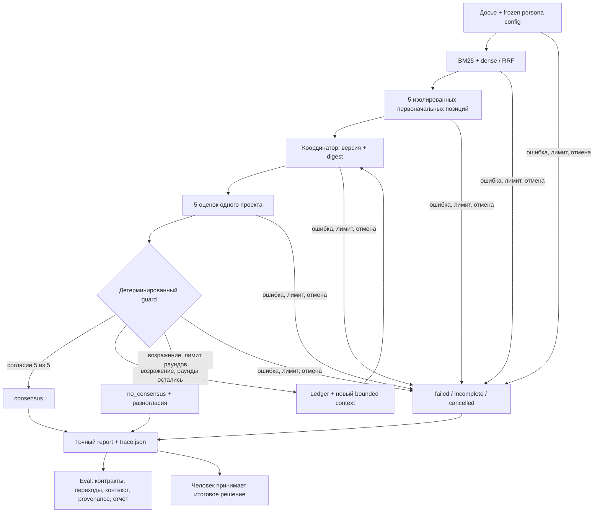

# Eval архитектуры Multi-Agent Consensus System

Revision r4, 2026-10-09. Цель — показать архитектуру принятого прототипа: независимость пяти первоначальных позиций, взаимодействие персон, управление версиями и контекстом, проверяемость аргументов и честное завершение. Текущий eval включает deterministic tests, scripted-model сценарии, локальные интеграционные проверки и разбор трасс. Live LLM, платные вызовы, провайдер и LLM-as-judge в этот этап не входят.

Фактическое evidence от **2026-10-08**: 54 tests passed, три CLI-сценария завершились с exit0, независимое ревью — pass; прототип принят пользователем. Источник результатов — [verification.md](verification.md). Это обновление документа; новые запуски сегодня не выполнялись.

## 1. Архитектура и единица оценки

Единица eval — запуск обсуждения над замороженным досье: пять исходных позиций, immutable версии решения, оценки каждой версии, ledgers, контексты, guard и итоговый report. Unit cases проверяют компоненты; сквозной сценарий проверяет их взаимодействие.

Peter Thiel, Warren Buffett, Robert Reich, Nassim Nicholas Taleb и Marcus Aurelius используют рамки из personas.md. Координатор синтезирует проект без права голоса. Код владеет состоянием, ID, лимитами и terminal status. Eval проверяет это распределение ответственности.



Eval — инженерный процесс поверх тестов и артефактов. Он не добавляет шестую runtime-персону, не голосует и не меняет результат. Ошибка записи отчёта означает отдельный отказ выдачи артефакта.

## 2. Четыре уровня проверки

| Уровень | Архитектурный вопрос | Метод и evidence |
|---|---|---|
| Контракты и политика | Может ли невалидный голос, ссылка, rationale или model-controlled команда пройти guard? | Unit/negative tests DTO, citations, exact check sets, identity, attempts и caps. Oracle — ожидаемое принятие или отказ. |
| Оркестрация | Сохраняются ли изоляция, пять участников, обязательства и новые голоса после пересмотра? | ScriptedAdapter; serialized requests, versions, ledgers и terminal status. |
| Источники и контекст | Доходят ли необходимые основания до следующего раунда и ограничено ли выполнение? | BM25/RRF fixtures, Tasker failures; actual Sentence Transformers для paraphrase; Windows child-process tests для cancel/deadline. |
| Сквозной результат | Совпадает ли отчёт с оценённым проектом и сохранено ли несогласие? | CLI на предоставленном досье, report.md/trace.json, независимое чтение кода и трасс. |

ScriptedAdapter заменяет генерацию позиции, проекта и оценки, сохраняя остальной runtime. Так воспроизводимо задаются возражения, ошибки и late responses. В CLI ingestion, Tasker wrapper, hybrid retrieval, context builder, LangGraph, guard и renderer проходят реальный путь исполнения.

## 3. Сценарии демонстрации

| Case | Контролируемое условие | Ожидаемый результат | Архитектурный смысл |
|---|---|---|---|
| T1 / agree | Пять approve V1 с полными checks | consensus, 1 версия, 11 model attempts: 5 initial + 1 coordinator + 5 reviews | Fan-out/fan-in и exact-version unanimity, без шестого голоса. |
| T2 / revise | Warren Buffett object V1; V2 отвечает на O1; владелец перепроверяет O1 | consensus после пяти новых V2 votes; 2 версии, 17 attempts | Feedback/revision loop, durable ledger и owner-authorized resolution. |
| T3 / disagree | Warren Buffett сохраняет возражение три раунда | no_consensus, 3 версии, 23 attempts; dissent остаётся в отчёте | Bounded termination; большинство не подменяет единогласие. |
| T4 / unsupported | Структурно допустимая оценка помечает claim или весь payload unsupported | Guard запрещает consensus | Связь evidence assessment с протоколом; распознавание смысла моделью здесь не оценивается. |
| T5 / regression | O1 resolved в промежуточной V2, но owner recheck отсутствует в V3 | Старый resolution не переносится; consensus запрещён | Обязательства текущей версии, а не накопление согласий. |
| T6 / conflict | Проверяются V1/V2 owner checks; отдельно после run пара исключается из ranking и реконструируется packet | Обе стороны pinned при реконструкции; current owner check/caveat обязательны для версии | Context Engineering и сохранение отрицательного evidence; ranking loss не инжектируется внутрь создания V2. |
| T7 / timeout | Adapter подавляет cancellation и возвращает ответ после срока | Expired attempt не принимается; нет late vote и task warnings | Runtime-owned request lifecycle, retries и cleanup. |
| T8 / context-deadline | Не помещается pinned closure или поиск превышает deadline | incomplete; pinned evidence не обрезается; late packet отвергается, native child останавливается | Лимиты действуют без потери оснований решения. |

T1–T3 — фактически выполненные CLI-демонстрации. T4–T8 — семейства controlled tests и независимых контрпримеров, а не дополнительные CLI `--scenario` значения. Сценарные позиции не предписывают рекомендации живой персоны.

## 4. Матрица E01–E12 и существующее покрытие

IDs из r3 сохранены для связи с дизайном и review history. Покрытие ниже описывает имеющиеся проверки; отдельный test существует не для каждого варианта расширенного требования.

| ID | Требование и наблюдение | Существующее evidence |
|---|---|---|
| E01 / personas | Initial без sibling positions/draft/votes; coordinator после пяти Positions; review без текущих sibling votes, с одинаковым evidence; fixed frozen roster | test_outcomes_and_isolation; test_initial_allowlist; test_fixed_frozen_personas. |
| E02 | Ровно пять текущих approve за одну run/snapshot/version/digest identity | test_five_guard_roster_exact; test_false_consensus_rejected; T1. |
| E03 | Исходные criteria и исторические blockers сохранены; owner checks заново на каждой версии; coordinator не снимает O1 | test_resolved_history_pending_again; T2/T3; ledger/checks_by_version в trace. |
| E04 | Exact sets checks и непустые причины; unsupported payload/claim, conditional verdict, unregistered assertions или foreign caveat запрещают согласие | test_false_consensus_rejected; test_each_check_group_requires_nonblank_reason; R12. |
| E05 | Две citations конфликта pinned после смены ranking; current owner disposition с caveat | test_whole_round_conflict_and_negative_pinning; test_conflict_caveat_cannot_disappear. |
| E06 | Citation ссылается на показанный frozen chunk и exact quote; transitive closure сохраняет основания | test_exact_seen_quotes; test_transitive_evidence_is_pinned; source/offset validation при indexing. |
| E07 | Rounds/attempts/ingestion/query/context bounded; overflow честный; общий deadline действует на query worker | test_attempt_and_context_budgets; test_source_bytes_bounded; test_query_limit; native tests; R14. |
| E08 | Model output не назначает roster/tools/next_agent/terminal | test_source_instructions_cannot_change_state отклоняет extra consensus/next_agent fields; это output-boundary fixture. |
| E09 | get_tasks → выданные IDs → details/subtasks; retry bounded; недоступный обязательный источник не empty success | test_sources.py: hierarchy/retry, exhaustion, KeyError, duplicates, identity/parent mismatch. |
| E10 | Same-frozen-input repair, max2 attempts; auth без retry; expired/cancelled output не принимается; cleanup без task warnings | test_model_boundary.py; native cancel/deadline; R13/R15. |
| E11 | Обе ветви поиска/RRF/stable ties; rare lexical hit, actual dense paraphrase hit, отсутствие truncation | test_retrieval.py; test_actual_dense_paraphrase_and_no_truncation. |
| E12 | Exact report payload/version/digest, пять voices, dissent/gaps/mode; нет post-vote rewrite; human choice не меняет status | test_cli_report.py; CLI artifacts; independent final-review. |

Файлы проверок: [council/tests](../../../../council/tests). Фактическое закрытие R12–R15: [final-review.md](final-review.md).

## 5. Метрики и критерии успешности

Метрики задаются до анализа результатов. Если измерения нет, пишется «не измерено», а не процент из количества passed tests. Отдельного eval runner в прототипе нет: assertions проверяют свойства, trace анализируется при инженерном review.

| Метрика | Расчёт или наблюдение | Критерий |
|---|---|---|
| False consensus | Consensus cases, где oracle требует запрета согласия / число таких cases | 0 на фиксированном negative-наборе. Успешный repair с валидным финальным payload не считается нарушением. |
| Version agreement | Consensus runs с пятью votes одной текущей identity / все consensus runs | 100%; при отсутствии consensus — N/A. |
| Isolation violations | Запрещённые поля в requests или synthesis до полного initial barrier | 0; RunState целиком не передаётся. |
| Obligation coverage | Корректные current owner checks / ожидаемые исторические obligations | 100% для принятого решения; resolved V2 не уменьшает obligations V3; при отсутствии obligations — N/A. |
| Evidence retention | Показанные pinned refs / transitive required refs, включая обе стороны conflicts | 100%, либо incomplete; optional chunks могут исчезать. |
| Citation validity | Принятые citations с shown ID, exact quote и правильным digest / все принятые citations | 100% структурной валидности; это не смысловая поддержка claim. |
| Terminal fidelity | Cases с ожидаемым status, сохранённым dissent и exact decision report / проверенные cases | 100%; no_consensus допустим; failed/incomplete/cancelled не маскируются согласованием. |
| Resource accounting | Trace attempts/rounds/elapsed; child returncode и отсутствие late output | Caps соблюдены; cleanup измеряется отдельно. Scripted token usage — null. |
| Retrieval checks | Rank размеченного semantic-only/rare-lexical источника; полное восстановление текста по offsets | Top1 соответствующей ветви в текущем fixture; отсутствие truncation. Это не corpus-wide recall. |

Architectural rubric reviewer: пять осей, каждая 0–2. **0** — требование отсутствует/нарушено; **1** — описано или реализовано, но нет достаточного executable evidence; **2** — реализация и positive/negative evidence согласуются.

| Ось | Что необходимо для 2 баллов |
|---|---|
| Orchestration | Пять изолированных позиций, synthesis/review barriers и bounded revision подтверждены requests/traces. |
| State/consensus | Immutable versions, exact unanimity, owner checks и честные terminal outcomes. |
| Context Engineering | Allow-list, одинаковый review evidence, transitive pinning и отказ при overflow. |
| Retrieval/provenance | Обе ветви, actual dense test, frozen origins/offsets и citation boundary. |
| Failure/observability | Retry/expiry/cancel/late-result tests, trace и точный report объясняют завершение. |

Максимум 10 баллов; выставляются только со ссылками на evidence. Rubric подготовлен для архитектурного разбора, суммарный балл сейчас не выставлен. Критический fail блокирует результат независимо от суммы: false consensus, потеря исторического blocker/отрицательного evidence, принятие late vote, подмена версии в report или игнорирование обязательного источника.

## 6. Воспроизводимость и границы

Case описывается полями: case_id, E-IDs, question, snapshot/persona/config identity, controlled adapter responses/tool faults, expected status/round transitions, forbidden outcomes, наблюдения request/trace/report и источник oracle. При исправлении сохраняется исходный failed case и closure evidence. Смена вопроса, источников или конфигурации требует нового run, а не правки старой трассы.

Существующие tests являются executable cases; fixtures задают разрешённое/запрещённое поведение, а не единственную цепочку рассуждений. Независимый инженер проверяет код, assertions и traces. Дополнительный runtime evaluator не нужен.

```powershell
.\.venv-consensus\Scripts\python.exe -m pytest council/tests -q
.\.venv-consensus\Scripts\python.exe -m council.main --mode scripted --scenario agree
.\.venv-consensus\Scripts\python.exe -m council.main --mode scripted --scenario revise
.\.venv-consensus\Scripts\python.exe -m council.main --mode scripted --scenario disagree
```

Команды воспроизводят существующий offline eval из project root; новых результатов от 2026-10-09 нет. Actual dense test использует локальную embedding-модель и может потребовать первичную загрузку весов. Это не live LLM-проверка.

| Сценарий | Архитектурные артефакты | Наблюдение 2026-10-08 |
|---|---|---|
| agree | [report](../../../../council/output/9c5e7e81fc9d4565b5904c83e7b1ba87/report.md), [trace](../../../../council/output/9c5e7e81fc9d4565b5904c83e7b1ba87/trace.json) | consensus / V1 / 11 attempts |
| revise | [report](../../../../council/output/2a5a1ace41634f198420ad79c74537d8/report.md), [trace](../../../../council/output/2a5a1ace41634f198420ad79c74537d8/trace.json) | consensus / V2 / 17 attempts |
| disagree | [report](../../../../council/output/ad3bd757a6984309bcf5f1005a44dcfc/report.md), [trace](../../../../council/output/ad3bd757a6984309bcf5f1005a44dcfc/trace.json) | no_consensus / V3 / 23 attempts |

Каждый run: 89 sources / 298 chunks. Ответы заданы сценарными fixtures; источники, поиск, состояние и renderer проходят реальную реализацию. Так eval демонстрирует архитектуру без текущих live-проверок.

Границы покрытия: не каждый вариант исходной расширенной матрицы E01–E12 имеет самостоятельный negative test, например каждый caveat/section-ref mismatch и каждый tool-failure variant. Corpus-wide recall, содержательная обоснованность итогового решения, различие reasoning пяти промптов и устойчивость живой модели к давлению группы здесь не измеряются. Выполненные 54 проверки подтверждают конкретные архитектурные свойства; иные случаи можно расширять в том же offline режиме. Отдельного плана live-запусков в текущем eval нет.

r4 заменяет предложение live-evaluation архитектурным offline eval по прямому уточнению пользователя. Runtime/design r3, принятая реализация и исходное evidence сохранены.